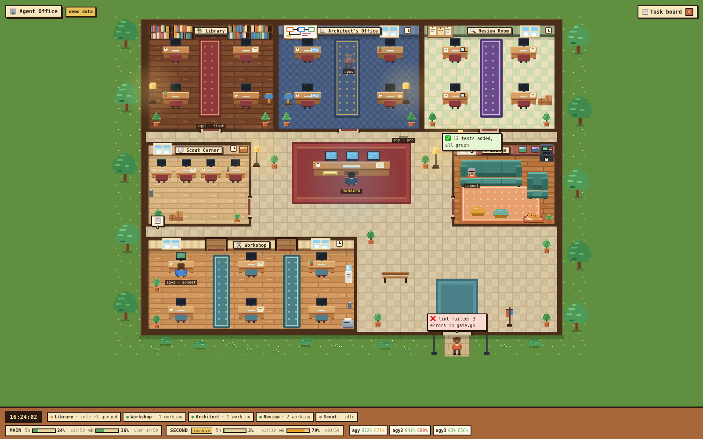

# agent-control

A small control layer for running **Claude Code** and **Google Antigravity (agy / Gemini)** side by side without blowing through your limits.

- **Budget hook:** every prompt gets a `[budget]` block with the 5-hour / weekly usage of each Claude account and each agy account, so the model routes work itself (cheap reading goes to agy, code goes to Claude).
- **agy wrapper:** `ctl.py agy` runs a headless agy task, rotates between several Google accounts, falls back on quota/login errors, and logs token usage.
- **Manager mode + task board:** one chat dispatches tasks to sub-agents and records each one on a board. That chat never asks for a "new session"; auto-compaction handles its size.
- **Agent Office:** a pixel-art office at `http://localhost:2000` where every running task is a character sitting in its room (Library, Workshop, Architect's office, Review room, Scout corner), with live budget meters.



## Requirements

- macOS (the status line uses the Keychain, the office uses launchd)
- Python 3.9+ (stdlib only)
- [Claude Code](https://docs.claude.com/en/docs/claude-code) and, optionally, the `agy` CLI
- Node 20+ and pnpm (only to build the Agent Office UI)

## Install

The scripts expect to live in `~/.claude-control`.

```bash
git clone https://github.com/thexayotbe/agent-control ~/.claude-control
cd ~/.claude-control
cp config.example.json config.json        # then edit accounts / agy homes
ln -sf ~/.claude-control/bin/ai ~/.local/bin/ai
```

The Keychain service name of a second Claude account (for example `~/.claude-second`) can be found with:

```bash
security dump-keychain | grep -o '"Claude Code-credentials[^"]*"' | sort -u
```

### Hook Claude Code up

Add to `~/.claude/settings.json` (use `second` instead of `main` in the second account's settings):

```json
{
  "statusLine": { "type": "command", "command": "python3 ~/.claude-control/bin/ctl.py statusline main" },
  "hooks": {
    "UserPromptSubmit": [
      { "matcher": "", "hooks": [ { "type": "command", "command": "python3 ~/.claude-control/bin/ctl.py hook main", "timeout": 10 } ] }
    ],
    "PreToolUse":   [ { "matcher": "Agent|Task", "hooks": [ { "type": "command", "command": "python3 ~/.claude-control/bin/ctl.py track", "timeout": 5 } ] } ],
    "PostToolUse":  [ { "matcher": "Agent|Task|mcp__t3.code__delegate_task", "hooks": [ { "type": "command", "command": "python3 ~/.claude-control/bin/ctl.py track", "timeout": 5 } ] } ],
    "SubagentStop": [ { "matcher": "", "hooks": [ { "type": "command", "command": "python3 ~/.claude-control/bin/ctl.py track", "timeout": 5 } ] } ]
  }
}
```

The `track` hooks put every sub-agent and T3 `delegate_task` from **any** chat on the board and mark it done when it finishes.

Load the routing rules and helpers in every session:

```bash
echo '@~/.claude-control/ROUTING.md' >> ~/.claude/CLAUDE.md
mkdir -p ~/.claude/agents ~/.claude/commands
ln -sf ~/.claude-control/agents/*.md ~/.claude/agents/
ln -sf ~/.claude-control/commands/manager.md ~/.claude/commands/manager.md
```

### Agent Office

```bash
cd ~/.claude-control/office/web && pnpm install && pnpm build
sed "s|__HOME__|$HOME|g" ~/.claude-control/office/com.claudecontrol.office.plist \
  > ~/Library/LaunchAgents/com.claudecontrol.office.plist
launchctl bootstrap gui/$(id -u) ~/Library/LaunchAgents/com.claudecontrol.office.plist
open http://localhost:2000
```

After changing the UI, run `pnpm build` again. The server picks up the new build without a restart. For live development, use `pnpm dev` (it proxies `/api` to port 2000).

## Usage

| Command | What it does |
|---|---|
| `ai` | Budget dashboard for all accounts |
| `ai main [model]` / `ai second` | Start Claude on an account |
| `ai ask flash "…"` | One-shot agy question in the current folder |
| `ai agy list \| check \| add \| login \| on \| off` | Manage agy accounts |
| `ai board [--all]` | Task board in the terminal |
| `ai office` | Open the Agent Office |
| `ai report [days]` | Where the tokens went |
| `ai style short\|normal`, `ai warn 70 85 95` | Reply length, alert thresholds |
| `ai tone roast\|normal` | Reply tone: `roast` = blunt Russian slang with swearing (chat only, never in code or commits) |

### Manager mode

Type `/manager` in any Claude Code chat. From then on:

1. The chat only dispatches work. Reading and drafts go to agy, code goes to Claude Sonnet, and large or cross-repo work goes to Claude Opus.
2. The board fills itself: the `track` hooks log every sub-agent and delegated task, and `ctl.py agy …` runs log themselves. Manual entries are still possible:
   ```bash
   ctl.py board add sonnet "Fix login redirect" --repo web-app   # → prints a task id
   ctl.py board set <id> done "tests pass"
   ```
3. Ask `status?` at any time, or watch the office.

Board agents and their rooms:

| Agent | Room |
|---|---|
| `agy-flash` | Library (reading, web research) |
| `agy-pro` | Review room |
| `sonnet`, `agy-sonnet` | Workshop (code) |
| `opus`, `agy-opus` | Architect's office |
| `haiku` | Scout corner |

Every open Claude Code chat also shows up as a 💬 character: at the Chat desks while it's working, in the Lounge while idle.

## Layout

```
bin/ctl.py          budget hook, status line, agy wrapper, board, state-json
bin/ai              user-facing CLI
ROUTING.md          routing and budget rules loaded into every session
agents/             architect / worker / scout sub-agent definitions
commands/manager.md the /manager slash command
config.example.json accounts, agy accounts, thresholds
office/server.py    stdlib server: web/dist + /api/state (port 2000)
office/web/         React + TypeScript + Tailwind v4 + motion UI
```

Runtime data (`state/`, `ledger/`, `handoffs/`, `board.json`, `config.json`) stays local and is git-ignored.

## License

MIT
